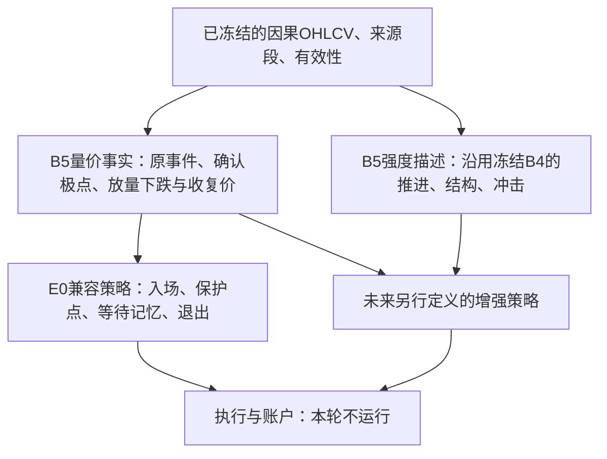

# B5：量价证据、强度描述与参与策略分离 v1

2026-10-25。用户授权独立实现B5，保留E0所需的量价证据并加入强度描述，先验证关闭增强规则后逐日复现E0；旧E0、B4不改，不运行新账户。

本版的新增是**可独立消费的证据接口与策略接口**。强度计算原样沿用冻结B4，并不同时推出另一套强度公式。B5不等于一个新的买卖策略，也不把兼容成功解释为收益改善。

本轮核验完成：15条冻结来源、35,587个有效价格观察，原事件、E0全部政策状态/记忆及保护点零差异；60个真实物理前缀与184项技术检查通过。这里的100%指登记验证范围内的逐值精确一致，不是收益保证。

完整研究入口：[B5研究与核验](../research_rounds/pv-strength-b5-20261025/README.md)。E0原公式见[固定规范](ALGORITHMS_E0_R_R1.md)，B4强度全部公式见[B4规范](ALGORITHM_B4.md)。本版不会覆盖这两份旧规范。

## 1. 分层后的含义



算法和策略都可以有历史状态。区分标准不是“有没有记忆”，而是记忆服务于什么：算法记住极值、量价证据和确认方向；策略记住自己选择参与的结构、保护点及等待哪次收复。事实不能因为策略选择空闲或持有而被改写。

本版事实层可以在E0已经有效时仍记录新的放量下跌候选；E0兼容策略会按原规则忽略它，不创建等待记忆。这样才能同时做到市场事实独立、原交易行为不变。

## 2. 三个接口

| 接口 | 输入 | 输出与责任 |
|---|---|---|
| `evidence.build_evidence(f)` | OHLCV、来源段、价格与强度两种有效性 | `frame, journal`；不含E0的target、入退、保护点或pending |
| `policy.e0_policy(frame, enhancements=False)` | 上一步事实表，可从文件重载，也可删掉全部强度列 | `state, ledger`；单独维护原E0参与政策，不读取行情文件、不调用原E0政策函数 |
| `api.run_b5(f, enhancements=False)` | 同一份输入 | 返回evidence、journal、state、ledger四项，方便研究调用；不生成账户交易 |

`enhancements=False`是本轮唯一实现的策略模式。`True`明确报未实现，不能把尚未研究的增强策略当成已存在功能。策略输出target是参与资格，不是实际成交持仓。

事实表包含131列：8个输入字段、12个观察/量价事实字段、10个旧事件字段、101个带 `strength_` 前缀的B4字段。journal为两个独立列表：`events`记录纯事件/候选事实，`strength`原样保存B4日志。

历史策略只可读取当前日期及以前的行与事件；frame attrs中的B4 terminal是本次批量输入的最后状态，不是每行当时可用的证据，也不是完整增量续算checkpoint。兼容政策不读取attrs。文件传输须保留声明类型，验证工具的Parquet sidecar仅恢复object日期/缺失表示，不修改浮点证据。

## 3. 输入、分段与三个时序

输入显式要求 `open/high/low/close/volume/segment_id/valid_price_observation/valid_strength_observation`。

索引须无时区、无NaT、有序唯一且一天最多一行；两个valid列是无缺失布尔。段编号明确非空、不能回返复用；不同编号若字符串化后碰撞也拒绝。有效价格须OHLC正且有限、几何关系合法。强度有效必须属于价格有效，并满足C/V正且有限。

每段有三个独立的零基计数：

1. **价格时序**：所有显式有效价格行，包括缺量、零量等行。前收盘、等待时长、保护点检查和旧记忆收复沿这个时序推进。
2. **原事件时序**：价格有效行中C/V均正且有限的子序列；原E0摆动事件按它计算，再映射回价格时序。
3. **强度时序**：只使用显式强度有效行。它是价格时序的子集，但不强制等于原事件时序；人为排除某行强度不能把它从E0事件核删除。

价格无效行的E0事实与政策输出未知，不触发动作、不推进等待时长；下一有效行跨过缺口比较真实价格。显式新段重置算法和政策，上一段未决记忆归档为open，不伪造一次市场退出或记忆否决。

这些是B5的显式适配合同。对照旧E0时必须把同一段、同一有效价格子序列交给旧函数。没有正有限成交量的整段，B5给未准备状态；原事件函数会拒绝该输入，此扩展边界单列，不能宣称旧函数本来接受。

## 4. 量价事实的公式

### 原E0摆动事件

下列t按原事件时序，价格比较、极值并列处理与局部对数函数完全保留原数值约定：

```text
r_t = log_ratio(C_t, C_(t−1))
σ_t = max(sqrt(fsum(r_(t−63)^2, …, r_(t−1)^2) / 63), 1e−8)
B_t = median(V_(t−21), …, V_(t−1))
```

在t=64首次准备完成，初始摆动方向d=−1，初始极点e=t。向下摆动遇严格新低才更新极点，向上摆动遇严格新高才更新；并列保留旧点。当t>e：

```text
A_(e,t) = clip(sqrt(mean(V_(e+1), …, V_t) / B_e), 0.5, 2)
K_t = (−d) × log_ratio(C_t, C_e) × A_(e,t) / (sqrt(5) × σ_e)
```

K达到1即确认−d方向的事件，输出已确认极点价格和发生日期，但证据只在确认日可用；随后d反转、极点重置到确认日。提取后的事件核只保留该计算，不执行原函数中夹带的active、支持、target和入退逻辑。

### 高参与下跌事实

下列t按**价格时序**；将缺失、非正或非有限V置空，但保留其在21行窗口中的位置：

```text
volume_baseline_t = median(此前21个价格观察的有效V；不足21个非空则未知)
volume_ratio_t = V_t / volume_baseline_t
declined_t = (C_t 严格小于前一个有效价格收盘)
high_effort_t = (volume_ratio_t ≥ 2 且有限)
decline_candidate_t = ready_t 且 declined_t 且 high_effort_t
candidate_lower_t = 当日最低价L_t
candidate_reclaim_t = 前一个有效价格收盘
```

候选上下界仅在candidate为真时公开；ready在原事件首次准备完成之后保持，直到来源重置。事实层不决定接纳哪一个候选，也不决定是否入场。低价L信息由此保留，修复B4-only接口中不可区分98/94保护点的根本缺口。

### 原算术边界

`compare(a,b)`在 `|a−b| ≤ γ4 max(a,b)` 时视为相等，其中 `u=eps64/2, γ4=4u/(1−4u)`。`log_ratio`在比较相等时为0，局部比值0.5—2内用log1p，其余用两个log之差。支持上移函数higher并列保留旧值。B5复制这三个纯函数的原操作，不改变容差或改用B4的32eps规则。

## 5. B5强度描述沿用B4

原B4模块按源码SHA-256固定加载，只加字段前缀，不重新定义尺度或温度。

- **推进**：`μ_h,t = (1−α_h)μ_h,t−1 + α_h r_t`，h=5/21、α=2/(h+1)。符号描述平滑净方向，10000×绝对值描述每有效观察的推进大小。
- **结构**：以滞后63收益绝对值中位数的1.4826倍作为尺度，按√21/√63冻结候选位移门槛。真实位移、新价格前沿、成交量信用同时满足才确认S21/S63。旧数据离窗不降低存续候选门槛。
- **冲击**：当日收益相对典型变动尺度，结合截断量比得到acute_up/down；只是当日事件，不表示冲击已修复。

全部初值、未知、重锚、量信用、浮点比较和101字段定义均按[冻结B4规范](ALGORITHM_B4.md)。仍无一个统一hot/cold总分。B4既有迟滞、陈旧结构和失败反弹限制不会因换成B5接口而自动消失。

## 6. E0兼容策略：关闭增强后的确切规则

策略单独保留active、floor及至多一个pending。每个有效价格观察按如下顺序处理：

1. 已有效且收盘触及或跌破旧floor：退出；标记当天不能重新入场。
2. 检查旧pending：收盘严格低于lower则否决，严格高于reclaim则收复，相等不响应。
3. 原向上事件优先：有效时仅抬高floor；空闲且当天未退出则入场，floor取确认低点。
4. 处理旧pending：被否决则清除；原事件已入场则记录被原通道消费；否则收复可独立入场，floor取pending.lower。
5. 最后才接纳今日候选：空闲、没有pending，且事实层decline_candidate为真时创建记忆。退出当天可创建，不能当天收复新记忆或重新入场。

原向下事件本身不退出，保护点不随普通回落降低；没有增加固定回撤线、止盈、排名换仓或强度门槛。未决记忆不自动到期，不被后来放量下跌覆盖。政策的完整字段和ledger与原参与函数逐项对照。

state整数列统一使用nullable Int64，确保未来出现未知行不会改变过去的字段类型。对旧state整数列显式转换到同一类型后逐值精确比较；floor等浮点不做容差放宽或舍入。ledger保留原类型，并追加segment_id。

## 7. 如何使用与如何判断通过

最直接的复用方式是只计算一次证据，再把它交给政策；政策可以在没有全部strength列的情况下独立运行。这里不会调用旧E0结果或旧参与函数来代替新策略：

```python
evidence, journal = build_evidence(input_frame)
state, ledger = e0_policy(evidence, enhancements=False)
```

兼容验收同时要求：原事件、入退、有效状态、保护点、全部pending字段和ledger一致；强度与冻结B4一致；删除/扰动强度不改变兼容政策；事实文件重载后政策一致；物理截断不重写过去；旧源码与结果保持哈希。

验证范围及成功/失败记录见[本轮结论](../research_rounds/pv-strength-b5-20261025/CONCLUSION.md)。本轮只完成兼容原型，不实施增强规则或账户。即使兼容测试全部通过，含义也是“原E0行为得到保留”，不是已经获得更高收益、更小回撤或更好的全市场选股。
