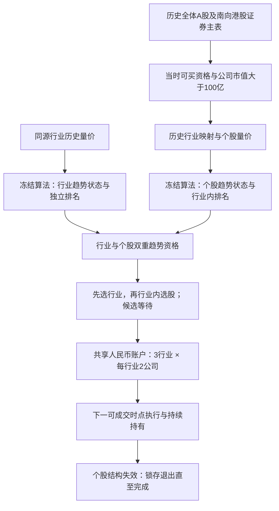

# 板块趋势选板块、个股趋势选股：交易与仓位研究方案

2026-10-22，设计版 v2（初版2026-10-21）。依据用户最新纠偏，遵守[研究共识 v3.4](RESEARCH_CONSENSUS.md)。本文件确定研究方向、方法和依赖顺序；新全市场数据、执行适配和回测尚未完成，不能将设计参数称为最优策略。

## 1. 纠正研究范围

本轮要回答：**在历史上当时合格的 A/H 股票中，先根据板块趋势选择板块，再根据板块内个股趋势选择股票，通过开仓、持有、卖出与适度分仓，板块信息能否改善大赢家实际参与与累计试错的经济取舍，并相对固定简单对照形成价值？**

此前877个账户建立在很小的固定资产范围上，最好结果来自三只ETF，相关诊断反复涉及的不同信号机会仅244个。那些工作对次时点执行、共享资金、权益核账、排队和仓位规则有复用价值，但**没有充分检验用户要求的全市场两级选股**。不能用旧小池无进展，推断全市场选股无效；也不能把旧策略的最好收益当成本轮答案。旧结果、失败和停止记录全部保留。

本轮保持“事件确认＋结构存续＋高参与下跌跨日收复”趋势算法冻结，分别用于板块和个股。先扩展正确的研究对象与策略映射，不根据旧ETF盈亏修改算法。ETF仅作市场参照，不进入本轮主策略的股票候选池。

## 2. 用户约束与研究默认值

| 项目 | 本轮规定 | 性质 |
|---|---|---|
| A股范围 | 沪、深、北交易所历史上市股票，含主板、创业板、科创板；保留后来退市、停牌、更名和换代码的公司 | 用户要求全部A股；不能偷偷只取今天存续者或旧A485 |
| 港股范围 | 交易当时属于沪港通或深港通南向股票买入名单的港股，两条通道取并集；保留仅可卖出状态 | 用户明确限制，不把北向名单或港股通ETF混入 |
| 市值 | 买入及加仓前，公司总市值严格大于人民币100亿元，即 `> 10_000_000_000 CNY` | 用户明确限制；不用流通市值替代 |
| 主架构 | 板块趋势选板块，再按板块内个股趋势选股 | 用户本轮明确主线，不能作为可有可无的附属诊断 |
| 行情愿景与风险 | 整户大行情80%仅作愿景/观察项；最大回撤研究目标20% | 80%不作为逐轮通过/继续门槛，20%不是触线强平，不隐含扩大风险 |
| 资金 | 首版研究本金100万元人民币，不融资、不做空 | 方法默认，不是用户实际本金 |
| 首版分仓 | 最多3个板块，每板块最多2个公司，共6个持仓槽；新增总投入目标不超过NAV的90% | 方法默认，之后单独比较分仓程度 |
| 资格下穿 | 市值下穿100亿或港股通移出时停止新买及加仓；存量按趋势退出和官方卖出规则处理 | 首版政策，不通过资格限制强迫锁盈；卖出不会因市值不足而被禁止 |
| ST等标签 | 不额外排除；按当时涨跌幅、交易、退市风险事实执行 | 不擅自增加预测过滤条件 |

“6个槽位”是同时持仓容量，**不是固定研究6只股票**。每天从当时全池重新形成候选，跨年可以参与大量不同公司。股票池大小不进入初仓资金分母，不能把原 `0.9/N` 的N直接换成全市场股票数。

## 3. 历史资格如何构建

### 3.1 时间与覆盖

目标账户区间为2015年首个交易日至2026-10-20，尽量复用或补齐2013年起的热身行情；新上市股票按实际观察数自然热身。港股按南向通道实际开通和当时资格加入，北交所按实际成立、上市和转板身份加入，不把后来市场身份回填此前。

每个交易日重建“上市身份→当时可买通道→历史市值→历史行业成员→可用行情”的资格链。不得先筛出今天市值100亿以上的股票，再仅下载这些股票的历史。先建立含退市的历史证券主表，复用历史股本、价格和市值数据，找出各公司曾经合格的区间，再重点补对应行情及热身。

所有已查看的2005—2026相关历史仍为开发/历史检验。2015—2017、2018—2020、2021—2023、2024—2026-10-20固定分段用于检查跨时期稳定性，不因此称为未见数据。真实前瞻从版本实际冻结记录之后开始。

### 3.2 公司总市值

优先使用同花顺可追溯的历史公司总市值字段，并先查清其股本、股类、币种和复权口径；有歧义时由历史原价和已生效股本重建。统一到发行人层面：

`公司市值_CNY(t) = Σ[各独立普通股类别的有效股数(t) × 对应类别原价(t) × 币种兑人民币汇率(t)]`。

单一A股类通常为含限售股的总股数乘A股原价；单一港股类以相应总股数乘港币原价再换算。A+H公司按A、H实际独立股类分别估值后相加，不能把同一份总股本在两地重复计入。同一股类的双币柜台、ADR等代表凭证不重复增加股本；特殊未上市股类须核对可用估值口径，不能随意指定价格。无法确认的记录列为市值未知，不能拿流通市值或当前股本补历史。

使用决策时已经可知且已经生效的股本与最近有效收盘原价。保留公告时间、生效时间、来源抓取时间三者；现在抓到的修订历史值不自动等于当时已知值。禁止复权价格乘原始股本、未来股本回填、固定今天汇率回算。资格门槛只用于可买范围，不参与趋势评分或市值排名选优。

A/H两条证券线路映射到同一 `issuer_id`。首版同一公司同时最多持有一条线路；已有持仓、待买或未完成卖出时不另买另一条。不研究A/H价差套利。

### 3.3 港股通与退市

港股通保存初始有效名单及后续调入、调出、仅可卖出、代码更换、生效日和公告时间。决策时可利用已经公告且将在执行日生效的变更；不能提前交易尚未公开的变更。沪、深南向资格取并集，同时核对实际可交易日历。

退市核对由研究程序承担。**“无后续行情”作为待核对异常，不能直接作为退市日期。** 相同现象还可能来自停牌、代码更换、合并、接口分页或数据缺口。按证券主表、终止上市公告、停复牌和代码沿革归类；不要求用户手工整理全部股票。

仓库已有[退市采集台账](../TradingAlarm/research/results/stock-data-audit/ths-retired-collection.json)：242条记录中239条已下载、3条标识未解。应复用并补证；239并不等于历史退市全集，且台账仍标记公司行为未验证。例如000005最后保存交易日为2024-03-05，主表退出日为2024-04-26，两者不能合并成同一个日期。

退市、换股或清算中的持仓保留至实际处置/权益结清。不能删除失败股票、假定最后收盘价必能卖出，或无限沿用停牌价让回撤消失。结局未确定时单列估值依据及保守处置情景；对结论有实质影响的未决损失未核清前，不给出“全市场已验证”的结论。

## 4. 板块与股票如何连接

主线使用真实历史行业体系。A股优先同花顺行业指数及同源历史成员；港股优先可取得配套历史指数和历史成员的同花顺或恒生行业体系。采集验证后一次性锁定每市场一个层级，不把一级、二级、概念板块同时混用，不按收益选择分类。

具体分类名、层级和指数ID仍须由数据证明，不能根据现有“90条行业指数”就宣称覆盖完整。指数的价格、量口径、停编和改编历史也要核实；成交量必须代表该指数自身可解释的参与量，不能用ETF成交量冒充行业总量。

- 每条成员边记录 `security_id, taxonomy, sector_id, valid_from, valid_to, announced_at, observed_at, source`。一个市场内每只股票在主层级只对应一个行业；分类调整按当时可知生效日处理。
- 指数应与其自身历史成员体系匹配。恒生行业指数不能配同花顺另一层级的当前成员。
- 各市场板块键分开，不能因为同名就混成一个指数。报告跨市场相近行业的合并暴露；“3个板块”不自动证明三个独立风险来源。
- 板块指数可以包含市值不足100亿的成员，因为它衡量整个板块的量价；交易候选再受100亿和港股通限制。对这种口径明确说明。
- 当前 `ths-industry-snapshot` 仅是快照，不能回填历史。旧ETF相关性代理分组保留为旧对照，不能悄悄成为本轮实际行业。

历史分类暂缺时，可以先计算已有可靠指数/股票的量价轨迹、验证时间连接及交易引擎；不能把少数配对成功的行业永久固定为研究宇宙。若必须更换分类或自建行业组合，先写独立方法说明及数据可用性证据，再冻结；不为了快速得到收益曲线跳过这一层。

## 5. 首版交易规则 S0

### 5.1 信号、排名与决策时钟

行业和股票使用同一冻结算法及参数，不设行业特供阈值。趋势输出仍为已有结构状态、形成/破坏/恢复事件及证据，不凭空构造“强度8分”。成交量继续实际影响高参与下跌记忆和跨日恢复。

相对排名单独计算，暂沿用[已检验的价格RS公式](../research_rounds/pv-participation-response-20261020/code/ranking.py)：

`RS = 0.4(C0/C63−1) + 0.2(C63/C126−1) + 0.2(C126/C189−1) + 0.2(C189/C252−1)`。

下标表示此前有效观察数，不是未来值。行业按各自指数RS排序，股票在当时行业内排序；数值计算、12位比较键和同分规则保持可追溯。RS不是绝对趋势强度，也不是市值评分。现有代码硬编码小池，必须新建动态池适配器，保留原代码和旧结果。

253个观察只影响RS可用性，不阻塞趋势建态。某次行业竞争批次存在缺RS时，该批次按稳定行业ID降级；某行业的股票竞争批次存在缺RS时，该批次按稳定证券ID降级，并记录原因。不能把未知当最低分，或因不满一年就静默排除新上市公司。

共同决策截点设在A/H当日收盘资料可获得之后，使用明确时间戳，订单只在其后的有效交易时点执行。休市市场可以保留最后已知状态和估值，但不把前次RS伪装成今天的新排名或虚构成交。行业/股票缺失观察属于未知，不机械转成0；未知期间暂停新买，已有退出意图继续保留。

### 5.2 开仓、候选等待与补位

定义 `Q_i(t)=可买资格 × 所属行业趋势有效 × 个股趋势有效`。只有各项已知时才判定0或1，另保留未知态。

Q从0到1创建候选，可由个股新趋势、板块后确认、市值首次达标、港股通调入或行业变更引起，各原因分别标记。账户起点已有双重趋势时允许一次初始化承接，单独标记，不强迫等待下一次破坏。缺数据后恢复观察不能伪造一个新的趋势事件。

候选在资格和双重趋势仍成立期间保留，未获得槽位或资金也记录等待。每个决策日按**当前行业排名，再按行业内个股排名**选择尚未开始成交的候选；不沿用旧小池“最老信号一律优先”的策略。先按行业顺序每行业取一只，再进行第二轮补位；持仓和已承诺待买共同占用3行业/每行业2公司/总6槽上限。同一公司的双地证券按当时排序取优先线路，同分稳定代码裁定。

已有部分成交订单的剩余目标优先完成，不被新高排名候选抢走。Q失效取消未完成买入；数据未知时暂停等待，不生成新目标。排名下降不卖已有持仓，不因行业跌出排名前列机械换股。槽位空缺后，可从仍有效的等待名单补位；这使策略能接上先形成但当时资金不足的趋势。

分类迁移导致存量超过行业槽位上限时保留存量，不强卖，暂停会扩大超限的新买。无有效候选、现金不足或受交易限制时持有现金，不强行满仓。

### 5.3 仓位与共享资金

首个获得槽位的决策收盘，按当日NAV形成初仓预算上限 `B=0.90×NAV/6`，即通常15%净值。另受可用资金及 `0.90×NAV−存量市值−已预留买入金额` 的正剩余限制；费用另预留。CNY为整户记账币种，A/H共同竞争资金，没有事后把两个独立满仓账户平均的做法。

同时冻结预算上限与按决策原价、历史委托单位计算的目标股数上限。以后开盘跳空上涨时可向下裁量以不突破原预算，跳空下跌不增加原目标股数；部分成交只消耗既有剩余额度，拆股按事件调整。不能每日重算初仓预算来持续补满。

每次持仓只有这一笔初始目标，首版不主动加仓、不按浮盈减仓、不每日等权。赢家自然增长使权重超过初始15%或整户90%时不强制卖回；这时不新增扩大总投入。最大实际行业/公司权重完整报告，不能把初始槽位上限当成实时市值上限。

港股首版按南向港股通人民币交收建模，港币成交面价、参考/结算汇率及应收应付分别记账。旧直投港股的HKD现金假设不能未经适配直接套用。卖出未结算或跨市场尚不可复用的资金不能当即时现金；研究佣金可用明确默认值，不需要用户先提供券商账户。

### 5.4 卖出与重入

主版S0：个股趋势结构失效，在收盘创建退出意图，下一个可成交时点卖出，直至本体退出完成。板块状态转弱只停止该板块新买；“板块破坏也退出个股”留作单独卖出机制对照。

退出锁存，途中状态恢复不能撤销未完成卖单。退出完成后，若双重资格仍成立，可产生一次明确标记的重入候选，重新竞争槽位与资金。不继承旧初仓预算，也不静默双倍买入。

没有固定止盈、30%止盈、回吐比例止盈或排名止盈。结构失效价不是保证成交的止损价，跳空、跌停和停牌造成的损失按实际可成交路径入账。

## 6. 数据采集与回测框架

先做可复用的数据层，再批量算一次信号，最后重放不同策略；不让每个账户重新联网或重算同一算法。

| 数据表 | 必需内容 | 首要来源/处理 |
|---|---|---|
| 证券与发行人主表 | 历史上市/退市、代码沿革、市场/板、发行人及股类 | 同花顺主表、退市代码与已存文件；公告补证 |
| 原始日线 | 原价OHLC、原量、单位、日期、停牌/无交易区别 | 本人已授权同花顺节点；复用已校验缓存 |
| 股本与市值 | 公告、生效区间、各股类股数、公司总市值及口径 | 同花顺历史字段；与原价和权息交叉核对 |
| 行业与成员 | 同源指数量价、历史成员与生效/可知时间 | 同花顺优先；港股可用配套恒生体系 |
| 南向资格 | 沪/深股票调入调出、仅卖出、变更时间 | 同花顺并用沪深交易所南向公告核实 |
| 公司行为 | 分红、拆并股、配股、证券分派、吸并及终止处置 | 同花顺原始权益、发行人/交易所公告补证 |
| 执行资料 | A股各板涨跌幅/委托单位/T+1、HK手数、南向日历、费用/汇率 | 按历史有效日期的规则表；不套用今天规则 |

数据保存原始响应和标准化表，校验代码/单位/日期/重复与分页覆盖，提供逐资产首尾、缺口、来源、哈希和排除原因。行情空白不能用零成交量或前日收盘填成一次新趋势观察。信号复权坐标与交易原价分离，未来新增权息不能改写过去决策；现金分红和证券权益只记一次。

日线执行采用次时点原价开盘及明确滑点代理。参与上限依据过去20个有效观察的原量，首版1%；当日成交量可以作为事后成交容量校验，不能参与前一日选股或下单预算。开盘即封板、全天一字、停牌等按规则禁止相应方向成交；没有逐笔证据时不得声称日线证明了开盘容量。需要分钟资料时，只对影响结论的疑似成交批次增量补取。

基础成本在首个账户之前冻结：经纪佣金、最低收费、历史税费、过户及交易征费、南向费用、汇兑和滑点逐项列明。真实税费按历史表，佣金和滑点的研究假设与官方费用分开。压力场景为可变交易成本加倍，以及额外延迟一个有效交易时点；不把旧15bps统一费率当成全市场真实成本。未知规则的账户只能标记技术演练，不能包装为完整执行回测。

### 有限采集顺序

1. **本地盘点与全体名册**：输出可复用数据覆盖、含退市的主表、未解代码表；核对已有239条退市记录，避免再次全量补数。首次网络请求前写明批次证券、字段、日期缺口和请求预算。
2. **首批链路验证**：最多24条证券线路，按数据类别事先选样，覆盖A股各板、退市/更码/长期停牌、A+H同公司、港股通调入调出/仅卖出，以及市值门槛上下穿。选样依据是元数据问题，不是事后涨幅。缺某类别就报告，不能假装凑齐。
3. **行业历史验证**：A/H各至少2个行业，在早期、中期、末期及一次真实成员变更前后取证，检验指数与成员是否同源、时间是否可靠。仅多张当前快照不能冒充连续历史表。
4. **增量扩展**：链路通过后按每批最多100条证券线路分片，缓存去重、断点续传。每批预先估算分页并设请求上限，单节点串行；认证拒绝即停止该会话，失败进入分类台账，不循环撞库。复用既有重试退避，不新开未授权节点。
5. **全池覆盖报告**：每日列出历史上市总数、确定达市值者、港股通可买者、行业/执行资料齐备者、未知者及排除原因；按市场、板、年份和退市状态分别展示。部分样本只能支持部分范围结论，不能靠“有数据者”定义全市场。

同花顺的产品能力与本机已授权客户端接口能力分别记录。官方iFinD文档显示可以取历史股本、按日板块数据和退市代码，不代表本人的客户端票据能调用所有iFinD接口。先在已授权节点和本地缓存完成字段验证；公开交易所资料可补证。不能把本人票据发往新iFinD目的地，也不能使用网页示例中的第三方凭据。

一个字段最多进行两批明确的接口/来源验证，仍无可靠历史则及时出具具体缺口、已试方法及替代证据；继续不依赖该字段的轨迹和框架工作，不让无限数据审计替代研究。对全池结论必要的缺口仍须补齐，不能用技术验收样本蒙混通过。

## 7. 首轮与后续研究顺序

先完成真实板块—股票的原始量价联动图检。固定样本同时覆盖板块先起/个股后起、个股先起/板块后确认、板块强而个股失败、板块弱而个股独涨、共同假突破、长期赢家与停复牌/权息转换；先写原始量价解释，再叠加冻结状态，不凭后验赢家挑图。保持失败、未知和不同解释。

首轮只研究“板块筛选和两级优先级对选股的增量”，本金、槽位、个股信号、费用和退出相同：

| 首轮版本 | 开仓资格与候选优先级 | 用途 |
|---|---|---|
| T0 个股趋势对照 | 个股趋势有效；所有合格股票按个股RS全局排队，保留相同实际行业槽位上限 | 基础个股趋势选择 |
| T1 板块资格对照 | 个股及其板块趋势均有效；仍按个股RS全局排队 | 与T0相比看板块趋势门控；包括其等待/取消影响 |
| S0 两级主版 | 双重趋势资格；行业RS优先、行业内RS选股、逐行业轮询 | 与T1相比看板块优先分配的整体影响 |

T0/T1的全局股票竞争如有缺RS，也按整批稳定证券ID降级。三个版本都使用真实行业映射和同一可用数据范围；T0不能因为不用板块信号就私自扩池。T1/S0比较的是明确的两级分配政策包，不把行业轮询贡献全归给一个RS数值。

三版本各运行基础、成本加倍、延迟一时点，共9个策略账户；另运行1个基础成本同池可交易被动账户，**首轮共10个账户**。全体证券信号可一次计算复用；不分别挑A股、港股各自最好版本再拼合收益。

同池被动账户在起点及每年首个共同决策日，以当时合格池形成90%总投入的等额目标，下一可交易时点先卖后买调整，按实际整手/费用/结算执行；年内无趋势调仓，资格失效停止新增并在下次年度调整处置，终止上市/公司行为另按事实处理。单名预算不足一手时留现金，不改成分数股或借钱。保存实际覆盖和现金偏差；补充同池理论等权指数及A/H宽基参照，注明它们不是同本金可执行成绩。被动组合若因整手留下大量现金，不能仅凭打赢它声称有选股优势，还须看T0及理论全池暴露。

首轮复盘先按当前执行计划作支持/否定/证据不足裁决。以下仅为可能的问题清单，不是自动执行队列；只有主要对照或共同机制证据支持时，才一次冻结一个追加问题及配置上限：

1. **分仓程度**：保留3板块上限，比较每板块1/2/3家公司，总槽位3/6/9，初始总预算均90%。只检验集中与分散的取舍，不同时改信号或退出。6槽控制可复用同身份旧结果。
2. **入场等待**：比较S0等待补位与“交集新形成时无槽位即放弃本次机会”；已经准入的部分成交仍用相同执行规则。判断晚补位是否创造尾部或扩大追高试错。
3. **卖出依据**：比较仅个股结构退出与“个股或板块结构破坏即退出”；不加入浮盈兑现条件，评价普通损耗和大赢家参与的共同变化。
4. **仓位管理**：只有前面复盘显示明确资金/初始试错问题时，再冻结一个结构风险初仓或分段加仓假说；不默认继承旧R16失败减半，不同时扫描多个预算和加仓阈值。

这些是条件式研究顺序，不是自动启动所有脚本的队列。若第一轮暴露输入或实现错误，修具体缺陷并保留前后结果；若只是收益不佳，不改行业体系、日期或筛选范围来挽救。

## 8. 判断是否有进展

每轮报告完整账户与全部对照，不只报告最好一行：

- 全期净收益、最大回撤、年度及固定时期收益、空闲现金、市场/行业/公司暴露、成本和未成交；解释收益来自选股、参与时点还是资金投入。
- 行情资格→板块资格→个股资格→排名落选→无槽位→无现金→不可成交→实际持有的完整漏斗；同时记录不同公司、不同趋势机会数，不能用重复账户数充当样本量。
- 闭合周期净收益≥30%为尾部，其他全部闭合周期为普通；开放持仓及未结清权益单列。普通净损耗/初始资金、普通损耗吞噬尾部的比例、连续初次失败、尾部资金贡献均报告；无30%止盈。
- 对最大赢家、主要普通损失、未入选的大趋势和排队失败作量价—状态—持仓联图复盘。完整交易集保留，主观分析不只挑支持策略的案例。
- 同一批历史资格日、行业变更、复权事件和正常日期上做真实前缀检验；对比截断重算的信号、排名、候选、订单和资金账，不只测静态算法。
- 独立账本逐日核对现金、股票、应收应付、费用和汇兑，逐周期损益与账户总额对齐。末日未平仓按市值报告，不虚构平仓。

大行情评价在运行前定义：按同池理论等权参照遍历全部252/504个共同账户观察窗口，参照净值涨幅≥30%者列为大行情诊断窗；报告所有符合窗的策略净收益、回撤及基准差异，同时保留全期和固定时期表。窗口重叠不当独立样本，后验大行情标签不用于交易。80%仅作情景愿景与描述项，不作为每轮晋升或继续条件；超过80%的一两个窗口不等于完成验证，未达到也不自动触发追加试验，不能只择最好起止。

最大回撤20%是研究目标，不是达到20%才强平的交易规则。利润回吐属于右侧持有代价，不以MFE兑现率优化退出。普通交易少量净亏损可接受，但必须定量展示其对整个行情收益的侵蚀。

“可靠进展”须在事前固定的完整主账户S0和主要对照T0上，结合成本/延迟、固定时期、尾部与普通损耗、现金及暴露体现可解释的经济价值。T1−T0、S0−T1只按事前定义解释机制，不事后换对照。仅某个小池或较弱中间版本改善可记局部发现，不能重置整个项目的停止计数。首轮10账户结束即作支持/否定/证据不足裁决；无共同新证据则停止该扩展，有证据才另冻一个有限追加轮。连续三轮不同问题无主要进展是最迟停止边界，不是必须跑满三轮。缺陷修复、完整负结论与局部发现分开记录，不以80%未到或新目录重置研究。

## 9. 交付物和当前下一步

本设计已完成；新研究入口是[本轮README](../research_rounds/sector-stock-20261021/README.md)及[设计协议](../research_rounds/sector-stock-20261021/protocol.proposed.json)。协议状态为 `design_only`，没有伪造数据哈希、分类覆盖或账户完成标记。

后续依次交付：

1. `coverage`：历史证券名册、现有缓存覆盖、来源能力和首批缺口表，附数据批次计划与原始证据。
2. `universe`：逐日资格、历史市值、港股通及行业成员，包含全部未知/排除原因。
3. `signals/review`：板块与股票固定量价图检、动态排名适配、因果和前缀验证。
4. `execution`：股票市场规则、南向交收、公司行为与共享账户适配及有限技术验收。
5. `results/r1`：事前冻结后的10账户、全量候选/订单/周期、独立核账、曲线与主观得失报告。

**D1本地盘点已完成；下一项实际工作是复核D2已保存的第1批响应，形成更码、历史市值、南向资格和行业成员裁决，再在剩余预算内接续验证。** 使用已授权本人同花顺接口完成必要增量查询，不要求用户提供全部历史数据。此阶段不重新全量下载，不继续旧小池策略扩展，也不把方案完成说成全市场回测完成。

## 10. 本次证据出处

以下网页本次已读取；证明资料或产品能力存在，不证明本机已取得完整数据或访问权限。

1. [港交所互联互通合资格证券入口](https://www.hkex.com.hk/Mutual-Market/Stock-Connect/Eligible-Stocks/View-All-Eligible-Securities?sc_lang=zh-HK)：南向沪/深入口与北向名单须区分。
2. [上交所港股通标的证券](https://www.sse.com.cn/services/hkexsc/disclo/eligible/)：当前名单及品种核对；当前快照不能直接回填历史。
3. [深交所港股通标的调整](https://www.szse.cn/szhk/hkbussiness/underlyadjust/index.html)：含调入/调出、生效日和公告链接；代码变更也可能呈现一出一入，不能直接解释为公司退市。
4. [同花顺量化平台数据文档](https://quant.10jqka.com.cn/view/dataplatform/detail/419)：历史股本序列、按日期查询板块的接口示例；iFinD接口与本机客户端能力分开验证。
5. [iFinD接口常见问题](https://quantapi.51ifind.com/gwstatic/static/ds_web/quantapi-web/help-center/faq.html)：在市/退市代码、权限及历史覆盖、取数失败和逐笔产品的边界。
6. 本地[退市采集台账](../TradingAlarm/research/results/stock-data-audit/ths-retired-collection.json)、[行业快照说明](DATA_SOURCES.md)、[旧回测交付](../reports/backtest-review-20261021/结果与数据需求.md)、[本次同花顺探测记录](../reports/backtest-review-20261021/ths-probe.json)。
