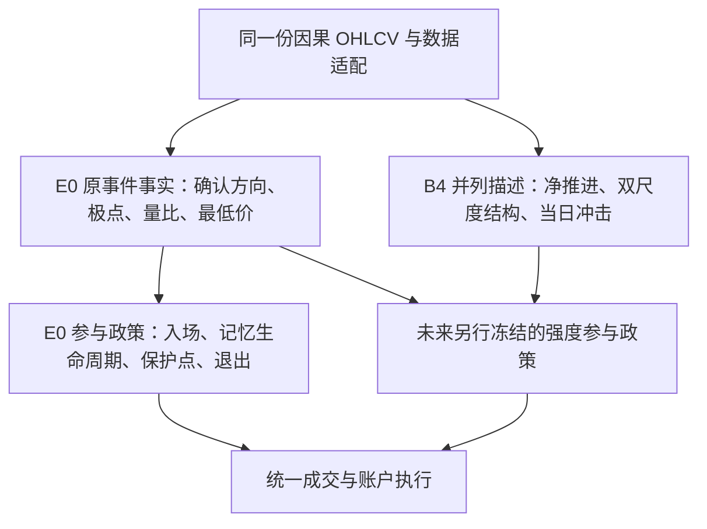

# 仅用 B4 输出的简单交易策略，能否100%复现 E0？

结论：**当前版本不能。** 这不是“还没有找到合适买卖阈值”，而是B4核心输出没有保留E0所需的全部信息。本轮直接调用冻结源码，构造了两段B4全部输出完全相同、E0退出动作却不同的合法量价路径，已经否定“对所有合法输入都能精确复现”的命题。没有运行账户回测。

用户指出E0包含开仓/卖出逻辑是准确的。旧文把E0概括为“市场结构状态”，不足以说明它的全部职责；它还包含明确的入场资格、持有、保护点维护及退出政策。把它的 `target` 称为资格而不是实际仓位，并不能消除这些政策选择。

## 1. 本次检验的“100%”是什么

固定同一原始行情、有效观察处理、初始化和数值边界，要求每个收盘时点的以下行为一致：

- 入场资格何时首次产生，来源是原事件还是放量下跌收复；
- 有效/无效状态，保护点及其更新时点；
- 卖出资格何时产生；同日退出不得重入等优先级；
- 未决记忆何时创建、否决、收复或被原通道消费。

不是“收益接近”，也不是“多数买卖日期相同”。相同信号要得到相同实际成交，还需相同执行器、初始账户、现金、排序、费用、停牌/涨跌停和订单生命周期；本次不检验完整账户。

对待证策略给予充分自由：它可以保留完整B4输出历史、事件日志和自己的策略记忆，不限定只能看当天数值。初始策略状态必须相同，且不能使用B4核心没有提供的原始最低价、E0结果表或未来信息。这样的策略仍不能精确复现E0。

## 2. E0实际包含的政策

权威来源是冻结的 [numeric.py](../pv-participation-response-20261020/code/numeric.py) 事件核和 [participation.py](../pv-participation-response-20261020/code/participation.py) 的 `participation_frame(mode='volume')`。前者内部的target不是完整E0。

E0的两个入场通道为：

1. 向上量价摆动事件确认后，空闲且当天未退出时入场，保护点取已确认的低点。
2. 空闲时出现量比至少2的下跌日，记录该日最低价lower与前收盘reclaim；以后收盘严格收复reclaim，且未先跌破lower、也未被原事件通道消费，则入场，保护点取lower。

有效期间，新的向上事件只可抬高保护点；**收盘小于或等于旧保护点则退出**。向下摆动事件本身不触发卖出。优先级是先检验旧保护点、再响应旧记忆、再处理原向上事件和旧记忆、最后创建新记忆；同日退出禁止再入。

这里“空闲才记忆”“原通道优先”“只抬高保护点”“触及或跌破旧保护点才退出”都是明确的参与规则，不能全部包装成无策略含义的客观强度。

## 3. 为什么B4不是换几条交易规则后的E0

| 项目 | 冻结E0 | 冻结B4 | 对精确复现的影响 |
|---|---|---|---|
| 原始价格信息 | 事件读C/V，量收复支持还读L | 核心只读C/V及有效性/分段 | B4无法区分同C/V但不同L的路径 |
| 事件门槛 | 前63收益RMS × √5，锚点冻结 | 前63绝对收益中位数 × 1.4826 × √21/√63，候选冻结 | 事件时点和被确认极点不同 |
| 量的使用 | 极点后整段平均量相对极点量基准 | 只累计首次新价格前沿的加权位移 | 往返成交作用不同；非同一参数的粗细调整 |
| 高量作用 | 可以降低确认所需的真实位移 | 仍必须走足冻结真实位移δ | 改S阈值不能视为恢复原检测器 |
| 初始化 | t64锚定当时收盘、先向下摆动 | t64建双向候选、初始锚t63 | 初始事件和前缀行为不同 |
| 支持与记忆 | 已确认低点保护线、放量下跌跨日收复 | 两尺度结构方向、反向候选、新前沿证据 | B4没有原支持/收复生命周期 |
| 数值比较 | 原价γ4容差、局部log_ratio | 归一log价、32eps容差 | 100%还包括边界行为，不能忽略 |

从源码差别可以判断，“S21转上就买、S21转下就卖”是另一个策略。仅仅改为“μ高于某值买、低于某值卖”也没有补回旧事件、保护点或收复记忆。不同事件公式本身不是普遍的信息不可能性证明；**下一节的同输出异动作反例才是严格证据**。

## 4. 已运行的67观察反例

这是一组人为构造的技术测试，不是历史黄金样本，不用于评价收益。两条序列各67个有效收盘，前64观察的收盘100、102交替、量100；其他OHLC合法且相同。第65观察只让最低价不同，其余输入完全相同：

| 阶段 | 两条路径共同收盘/量 | 路径A | 路径B |
|---|---|---|---|
| 前一观察 | 102 / 100 | E0未入场 | E0未入场 |
| 放量下跌日 | 100 / 200 | 最低98，记忆lower=98 | 最低94，记忆lower=94 |
| 次日收复 | 103 / 100 | 收复102，E0入场，保护点98 | 收复102，E0入场，保护点94 |
| 再下一日 | 96 / 100 | 96≤98，E0退出 | 96>94，E0继续有效 |

收复日原始摆动确认值只有0.6675426463，小于1，没有原始向上事件；所以两者确实都来自量收复通道，并非用mock事件人为制造分支。

验证结果：

- B4全部101个原生输出列、67行，以及17条事件日志与attrs终态完全相同；不含导入的e0列。
- E0在收复日保护点分别为98和94；随后同样收盘96，A的 `exited=1,target=0`，B的 `exited=0,target=1`。
- 两条序列分别截断至65/66/67行，6个物理前缀与完整输出的过去部分一致。
- 模型源码运行前后哈希一致；账户、下载、参数搜索、mock事件均为0。

完整[输入与运行核验](validation/compat-output-v1/verification.json)、[四行证据表](validation/compat-output-v1/witness-last-four.csv)、[确定性脚本](validation/prove_b4_e0_information_loss.py)及[独立审查](reviews/compat-proof.md)已保存。

证明很直接：设B4全历史输出为B(X)，E0行为为E(X)。此例 `B(A)=B(B)`，但 `E(A)≠E(B)`。任何相同初始状态、只读B4的确定性策略P，必有 `P(B(A))=P(B(B))`，不可能同时等于两种E0行为。允许更复杂策略记忆也不能恢复未提供的信息；随机选择也不能保证100%正确。

## 5. 三种不同说法必须区分

| 说法 | 本轮结论 |
|---|---|
| 只用当前B4原生输出，调整简单开仓/卖出规则就精确得到E0 | **不能，反例已证伪** |
| B4报告里已有e0_target，所以直接读取即可复现 | 这是调用旧对照结果，属于循环论证 |
| 策略同时读取完整原始OHLCV，重新执行原E0事件和参与逻辑 | 信息具备，可以运行原E0；但这是增加原算法通道，不是B4已包含E0 |

也不能把“任何趋势指标都必须复现所有历史算法”当作一般数学要求。但**对本项目“保留E0、增加强度，使E0成为可选策略”的目标，这个向后兼容测试非常合理；当前B4尚未达到它。** 已有因果与技术检查不应被表述成该目标已经完成。

## 6. 如何才能做到真正可验证的分层

需要保留E0所需的市场证据，再让策略决定怎样参与，而不是强迫两个不同的事件核互相拟合。

具体职责应为：

1. **市场证据层**：完整保留旧事件检测结果和生成条件所需的量价事实，同时旁路输出B4分量。层内不读实际持仓、成交价和盈亏。
2. **参与政策层**：E0政策保留原先的active、只抬高的支持、pending创建/消费顺序、退出优先级。尤其原pending仅在空闲时创建、可被原入场消费，这些生命周期规则不能全部挪到无条件事实层，否则会改变行为。B4增强政策另取版本，可选择暂不使用B4，退回原E0政策。
3. **执行层**：相同收盘信号在下一可成交时点执行，处理现金、排序、仓位、订单有效期、成本与不可成交。

该结构可以把“关闭B4增强后逐日复现E0”作为明确的兼容目标。要证明完成，须实际拆分后逐项对照旧源码：入/退、支持、记忆和顺序均一致，覆盖既有全历史、边界合成、分段缺失和物理前缀；仅账户收益相同不能替代行为等价。

**本轮只记录此架构与验收标准，尚未实施兼容层、重构E0或创建B4交易策略。** B4继续作为独立描述器固定，E0/R/R1保持原名原公式。阶段性成果是B4的分量解释与因果性质，不能提前称为已完成E0增量替代。
